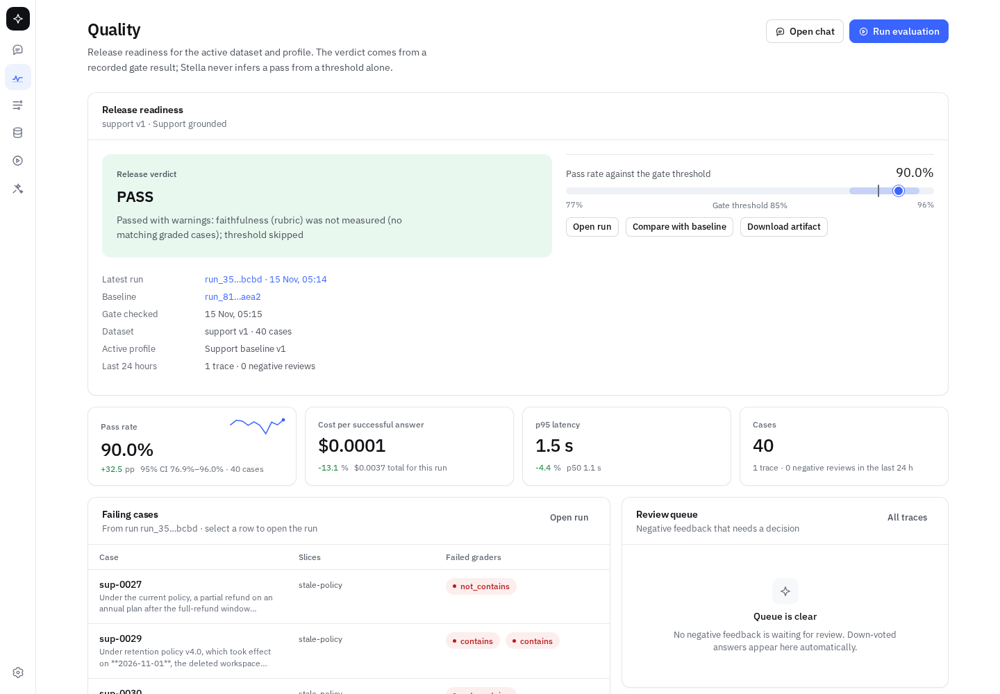
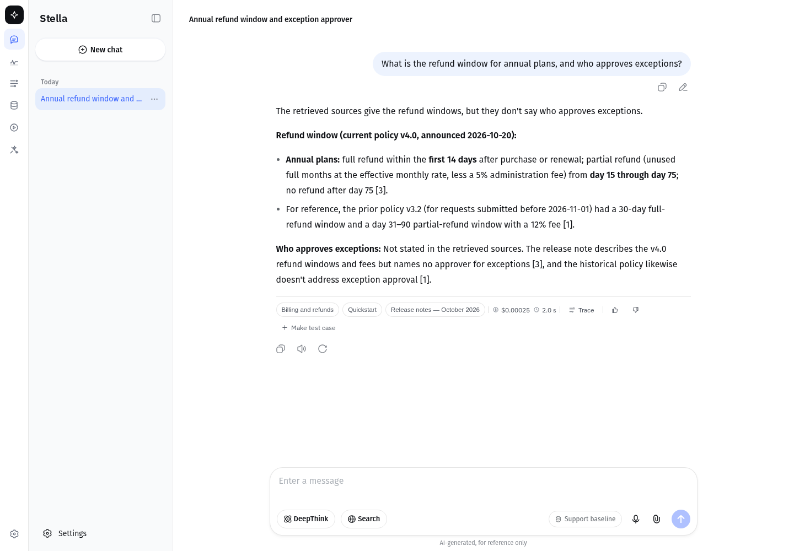
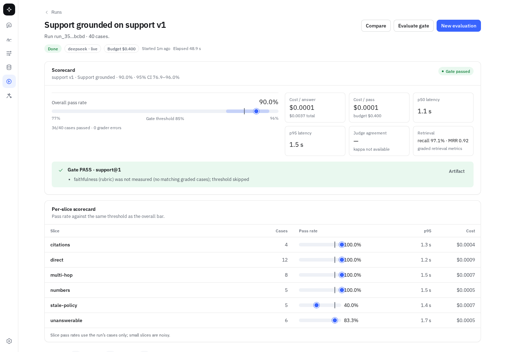

# Stella

**Every answer, accounted for.**

Stella is a local-first, chat-first workbench for teams shipping DeepSeek-powered assistants. It starts from DeepSeek's open-source [chat-demo](https://github.com/deepseek-ai/chat-demo) and turns it into a quality loop: **capture real chats → curate datasets → evaluate retrieval and answers → improve the profile → gate the release**, with a validated fine-tuning data pipeline and an honest account of what DeepSeek does and does not offer.

> Status: `v0.1.0`. The chat, gateway, retrieval, evaluation and release-gate loop
> are working end-to-end against the live DeepSeek API; replay for the rerank-on
> demo profile is still a labelled mechanics-only limitation.

## Live evidence (2026-11-15)

The bundled Meridian demo, run live on `deepseek-flash` off-peak:

| | Baseline | Grounded |
| --- | --- | --- |
| Pass rate | 57.5% | **90.0%** |
| Retrieval recall@k | 65.4% | 95.6% |
| Cost / successful answer | $0.00012 | $0.00010 |

+32.5 pp (95% CI +17.5…+47.5), **0 regressions**, release gate **PASS**, and a
33-example validated SFT export. The judge-enabled advisory run scored 82.5% with
κ = 0.391, which is exactly why judge calibration is shown but not used as the
gate. See the actual [release review](docs/examples/release-review.html) (PASS with the unmeasured rubric marked SKIPPED), the [gate Markdown](docs/examples/release-review.md), the [SFT manifest](docs/examples/sft-manifest.json), and [`docs/DEMO.md`](docs/DEMO.md) for the full run and honest limits.





## Why this exists

- DeepSeek's API has **no embeddings and no fine-tuning endpoints**; the useful work is retrieval, evidence, evaluation and data curation, not another model API wrapper.
- Teams evaluating assistants still stitch four tools together: traces in one product, cases in a spreadsheet, evaluation in a CLI, prompts in git, and a gate in CI. Stella makes trace → case → decision one artifact.
- Chat UIs and quality dashboards are usually different products. Stella's chat carries its own receipts: sources, cost, latency, trace and feedback attach to every answer.

## Quickstart

Requirements: **Node 24+** and **pnpm 11+**. No Python, Docker or cluster is required.

```bash
pnpm install
cp .env.example .env.local        # add DEEPSEEK_API_KEY for live mode
pnpm seed                         # demo collection, dataset snapshot, profiles
pnpm dev                          # server :8787, app :8090
# or run the whole loop headlessly
./bin/stella demo --live          # seed → baseline → grounded → gate → SFT export
```

Open http://127.0.0.1:8090 for the dev server, or:

```bash
pnpm build
pnpm start                        # serves the app and API on http://127.0.0.1:8787
```

Without a key Stella runs in replay/offline mode: traces, datasets and recorded evaluation results remain inspectable, but new model calls fail with an actionable message.

## The loop

1. **Capture** — the gateway in front of `api.deepseek.com` records every request/response, usage, cost, latency and retrieved source.
2. **Curate** — promote any assistant answer (and its sources) to a versioned JSONL test case.
3. **Evaluate** — retrieval metrics, deterministic assertions and a rubric judge with visible calibration; cost per successful answer; per-slice regressions.
4. **Improve** — versioned profiles (model, prompt, retrieval k/rerank/context budget), run comparisons and sweeps.
5. **Gate** — configurable thresholds and regression guards, CI exit codes and a release review artifact (Markdown, JSON, self-contained HTML).
6. **Fine-tune data** — deduplicated, redacted, split SFT/DPO exports with provenance and contamination checks; DeepSeek training is explicitly marked unavailable, with plans for Unsloth, Axolotl, Together or an OpenAI-compatible endpoint.

## CI

The GitHub Actions workflow is staged at [`docs/ci.yml`](docs/ci.yml). GitHub
blocks pushes of workflow files for tokens without the `workflow` scope; after
granting it, activate CI with:

```bash
mkdir -p .github/workflows
git mv docs/ci.yml .github/workflows/ci.yml
git commit -m "Enable CI"
git push
```

The same checks run locally with `pnpm type && pnpm lint && pnpm test && pnpm test:ui && pnpm build`.

## Stack

TypeScript on Node 24, Fastify gateway, SQLite (`node:sqlite`, FTS5), React 18 + rspack (the chat-demo fork), Playwright for visual checks. One package, one SQLite file, no external services.

## Documentation

- [`docs/RESEARCH.md`](docs/RESEARCH.md) — landscape research, API constraints, citations
- [`docs/product-facts.md`](docs/product-facts.md) — verified DeepSeek/chat-demo facts and sources
- [`docs/ARCHITECTURE.md`](docs/ARCHITECTURE.md) — components, data flow, decisions
- [`docs/EVALS.md`](docs/EVALS.md) — metrics, judge design, gates
- [`docs/FINETUNE.md`](docs/FINETUNE.md) — data pipeline and honest limits
- [`docs/API.md`](docs/API.md) — HTTP contracts and ownership
- [`docs/OPERATIONS.md`](docs/OPERATIONS.md) — setup, configuration, backup, troubleshooting
- [`docs/DEMO.md`](docs/DEMO.md) — the end-to-end demo
- [`UPSTREAM.md`](UPSTREAM.md) — chat-demo fork provenance and sync policy

## License and attribution

MIT. Stella is derived from [deepseek-ai/chat-demo](https://github.com/deepseek-ai/chat-demo), Copyright (c) 2026 DeepSeek, also MIT. See [`LICENSE`](LICENSE), [`NOTICE`](NOTICE) and [`UPSTREAM.md`](UPSTREAM.md).
